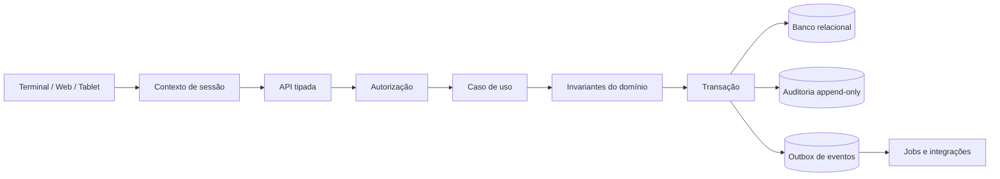
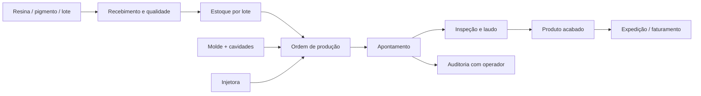

# ARCHITECTURE.md — Arquitetura do InjetaFlow

## Estilo arquitetural
Começar com monólito modular e evoluir por evidência. Organizar por domínio de negócio, mantendo apresentação, aplicação, domínio e infraestrutura separados dentro de cada módulo.

## Fluxo de uma mutação


## Fluxo de rastreabilidade


## Limites dos módulos
`identity`: tenant, unidade, usuário, sessão, papéis e registro. `production`: OP, ciclos, setup, produção, refugo e paradas. `quality`: inspeções, quarentena, laudo, RNC e liberação. `inventory`: recebimento, lote, estoque, WMS, pesagem e movimentações. `maintenance`: ativos, moldes, OS, ciclos, peças e paradas. `finance`: custo, faturamento, contas, fluxo e fiscal. `integrations`: IoT, balanças, EDI, leitores e fiscal. `audit`: eventos imutáveis.

## Estrutura recomendada
```text
src/
  modules/
    identity/
    production/
    quality/
    inventory/
    maintenance/
    finance/
    integrations/
    audit/
  shared/
    auth/
    database/
    errors/
    observability/
  ui/
    components/
    layouts/
    pages/
```

## Decisão importante
Não extrair microserviços no início. Use eventos internos e adaptadores bem definidos. Extrair somente quando houver necessidade comprovada de escala, isolamento ou disponibilidade independente.
